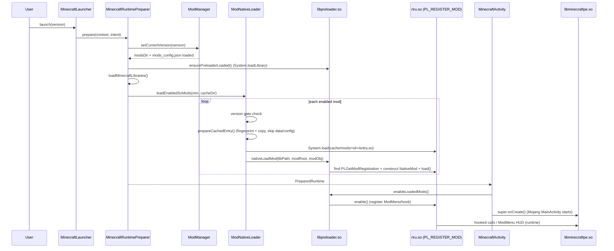

# Architecture — LeviLaunchroid `.so` mods

## Component map

```text
┌─────────────────────────────┐
│  Launcher UI (Java/Kotlin)  │
│  ModManager / Mod /         │
│  ExternalModsActivity /     │
│  InbuiltOverlayManager      │
└──────────────┬──────────────┘
               │ modsDir per GameVersion
               │ mods_config.json {name,enabled,order}
               ▼
┌─────────────────────────────┐      ┌──────────────────────────┐
│ ModNativeLoader (Java)      │─────▶│ cacheDir/mods/<modId>/   │
│ - version gate              │ copy │  entry .so (read-only)   │
│ - fingerprint (loader=4)    │ excl │  .mod_cache_manifest     │
│ - System.load(cached .so)   │ data/│                          │
└──────────────┬──────────────┘      └──────────────────────────┘
               │ JNI
               ▼
┌─────────────────────────────┐
│ libpreloader.so             │
│ - nativeLoadMod()           │
│ - PLGetModRegistration      │
│ - NativeMod registry        │
│ - ModMenu / Hook / Sig APIs │
└──────┬──────────────┬───────┘
       │ enable       │ UI bridge
       ▼              ▼
┌─────────────┐  ┌────────────────────────┐
│ riru.so etc │  │ ExternalModBridge (JNI)│
│ load/enable │  │ → ModMenu overlay      │
│ /disable/   │  │ → floating buttons/HUD │
│ unload      │  │ (InbuiltOverlayManager)│
└──────┬──────┘  └────────────────────────┘
       │ hook (optional, sig-resolved)
       ▼
┌─────────────────────────────┐
│ libminecraftpe.so (game)    │
│ ELF64 AArch64, stripped     │
│ OreUI/CoHTML StartScreen    │
│ .text ~196 MiB              │
└─────────────────────────────┘
```

## Sequence — launch with `.so` mods



## Filesystem layout

```text
<versionDir>/                          # GameVersion.versionDir
  base.apk.levi
  splits/*.apk.levi

<modsDir>/ == <versionDir>/mods  (per version isolation)
  mods_config.json                     # [{"name":"riru","enabled":true,"order":0}]
  riru/                                # modId == dir name
    manifest.json                      # {"type":"preload-native","entry":"libRiru.so",...}
    libRiru.so                         # entry .so (arm64-v8a)
    config/                            # editable, NOT copied to cache (runtime dir)
      config.json
      config.schema.json
    data/                              # runtime, NOT copied to cache
    resources/                         # copied to cache

<cacheDir>/mods/                       # app cache, actually loaded
  riru/
    libRiru.so                         # read-only copy, System.load() target
    .mod_cache_manifest                # fingerprint loader=4
    resources/...

fedora repo (this repo):
  docs/                                # loader + arch + reverse notes
  riru/                                # source package (modId = riru)
    manifest.json
    CMakeLists.txt
    src/RiruTest.cpp
  lib/                                 # pointer only; binary lives as Release asset
  .github/workflows/
    reverse.yml                        # Ghidra RE in Actions
    build-riru.yml                     # NDK build in Actions
```

## Data details

- Fingerprint: `loader=4 + id + entry + (rel|len|mtime)` per file, sorted. Cache reuse only on exact match.
- `ensureReadOnly`: cached `.so` must end read-only; prevents accidental overwrite while loaded.
- `Mod` object passed to native side carries `id/fileName/entryPath/displayName/minecraftVersions/author/version/.../modRoot/configDir`.
- `NativeMod` paths: `getModDir()` = source root (`modsDir/<id>`), `getLibraryPath()` = cached `.so`, `getConfigDir()` = `<root>/config`.
- Disable path: `disableAndUnloadLoadedMods()` → `disable()` → `unload()` per mod; ModMenu `unregister*` in `disable()`.

## Why `riru` needs no offsets by default

`riru` test button uses **ModMenu** (`ModuleBuilder` + `ButtonBuilder` floating button). That path is owned by `libpreloader.so` and the launcher overlay — no Bedrock address needed, no version fragility. The optional true-StartScreen hook is gated behind `RIRU_USE_HOOKS` and filled only from Actions-verified `offsets.json` (see `reverse.yml`).
